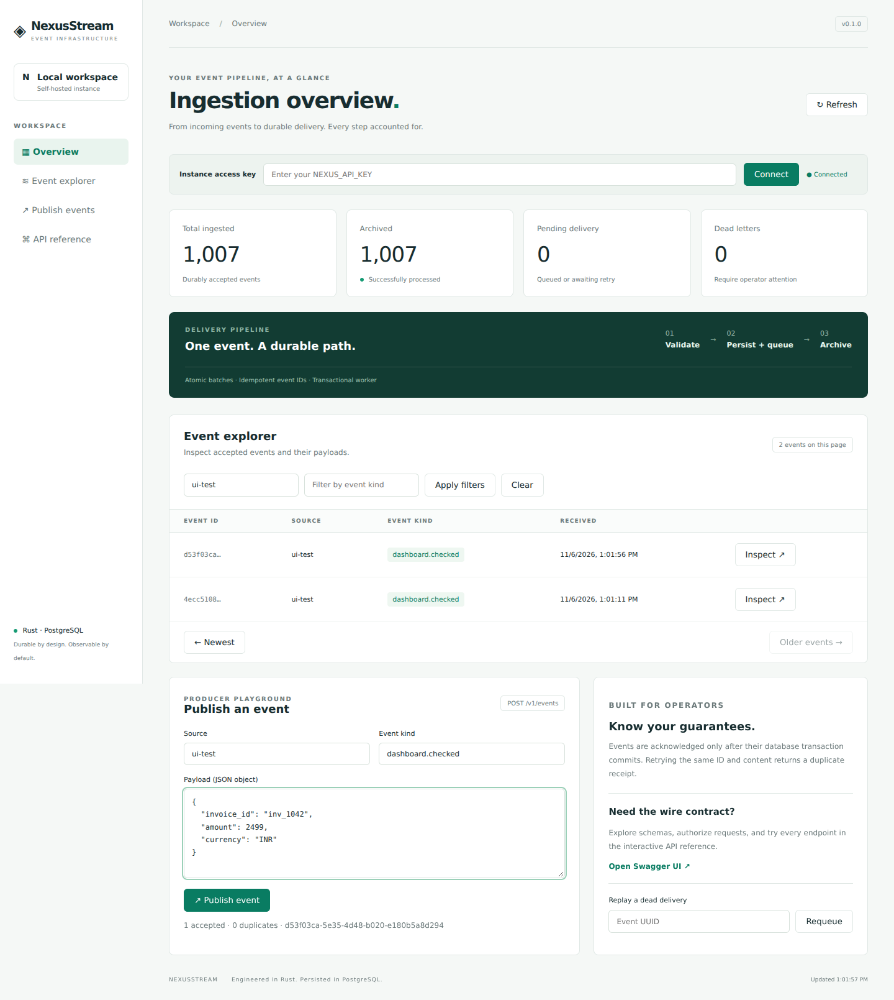

# NexusStream

**A durable Rust event ingestion service with an operator dashboard.**

NexusStream accepts versioned JSON batches, persists events and delivery records in one PostgreSQL transaction, and processes them with a restart-safe worker. A built-in dashboard and Swagger UI make the complete path inspectable.

Built as a three-crate Cargo workspace with explicit protocol, persistence, and HTTP boundaries. This is a self-hosted single-workspace service, with a durable internal archive sink. It does not claim Kafka compatibility or distributed exactly-once delivery.



## What you can do

- Publish batches of up to 100 events, with atomic acceptance and bounded payloads.
- Retry safely using producer-generated UUIDs. Identical retries are deduplicated; conflicting content returns HTTP 409.
- Explore events using source/kind filters, descending sequence cursors, and payload inspection.
- Monitor real event, pending, archived, and dead-letter counts from the dashboard or Prometheus endpoint.
- Recover failed deliveries with exponential backoff, a five-attempt dead-letter policy, and operator replay.
- Run multiple API/worker instances against the same database using `FOR UPDATE SKIP LOCKED`.
- Browse generated OpenAPI documentation and execute authenticated requests in Swagger UI.

## Quick start

Requires Docker Engine with Compose v2, and OpenSSL for generating credentials.

```bash
git clone https://github.com/sivajisj2/nexusstream.git
cd nexusstream
sh scripts/setup.sh
docker compose up --build -d
```

Open **http://localhost:8080** for the dashboard and **http://localhost:8080/docs/** for Swagger UI. Enter `NEXUS_API_KEY` from your local `.env` in the dashboard or Swagger's **Authorize** dialog. The key is kept only in dashboard memory, not browser storage.

The setup script generates random credentials and will not overwrite an existing `.env`. Compose publishes ports to loopback only. Data persists in the `nexus-data` volume.

```bash
# Export the generated configuration into the current shell.
set -a
. ./.env
set +a
python3 scripts/smoke.py
```

## Publish an event

```bash
curl -i http://localhost:8080/v1/events \
  -H "X-API-Key: $NEXUS_API_KEY" \
  -H 'Content-Type: application/json' \
  -d '{"events":[{"id":"7c5f5746-fd97-4da2-919d-0a1d06f97c2e","source":"billing","kind":"invoice.created","payload":{"amount":2499,"currency":"INR"}}]}'
```

The first request returns `202 {"accepted":1,"duplicates":0}`. Repeating it returns `202 {"accepted":0,"duplicates":1}`. Changing its payload while retaining the ID returns 409. A 202 means the database committed, not that downstream processing has completed.

## HTTP contract

| Method | Path | Purpose | Access |
|---|---|---|---|
| POST | `/v1/events` | Atomic batch ingestion | API key |
| GET | `/v1/events?limit=25&before=100&source=billing&kind=invoice.created` | Cursor explorer | API key |
| GET | `/v1/events/{id}` | One accepted event | API key |
| POST | `/v1/events/{id}/replay` | Requeue a dead delivery | API key |
| GET | `/v1/stats` | Durable queue counts | API key |
| GET | `/metrics` | Prometheus gauge exposition | API key |
| GET | `/healthz` | Process liveness | Public |
| GET | `/readyz` | Database connectivity | Public |
| GET | `/docs/` | Embedded Swagger UI | Public |
| GET | `/api-docs/openapi.json` | Generated OpenAPI schema | Public |

See [API details](docs/API.md) for errors, limits, retry rules, and pagination semantics.

## Local development

Requires the pinned Rust toolchain, a C linker, PostgreSQL 17+, and Python 3 for acceptance/load scripts.

```bash
sh scripts/setup.sh
docker compose up -d postgres
set -a; . ./.env; set +a
cargo run -p nexus-api
```

The application applies embedded, versioned SQL migrations before listening. SQLx queries use bound parameters and do not require a live database to compile.

```bash
cargo fmt --all -- --check
cargo clippy --locked --workspace --all-targets -- -D warnings
cargo test --locked --workspace
# A PostgreSQL role with CREATEDB is needed for isolated database tests.
cargo test --locked -p nexus-api --test database -- --ignored
python3 scripts/smoke.py
python3 scripts/load.py --events 1000 --concurrency 8
```

Database tests are explicitly ignored in the offline suite, and are explicitly executed in CI. See [testing guide](docs/TESTING.md) and [validation record](docs/VALIDATION.md).

## Workspace

```text
crates/nexus-protocol   Wire types, validation, JSON encoding/decoding
crates/nexus-store      SQL migrations, atomic ingestion, worker, queries
crates/nexus-api        Axum routes, authentication, OpenAPI, embedded UI
migrations/            Append-only PostgreSQL schema changes
web/                   Responsive dashboard; plain JavaScript and CSS
scripts/               Setup, acceptance checks, workload generator
```

The dashboard has no npm build step and is embedded in the Rust binary. Swagger assets are vendored by the Rust dependency. Google Fonts are optional cosmetic assets; system fonts work offline.

## Documentation

- [Architecture and guarantees](docs/ARCHITECTURE.md)
- [API and producer guidance](docs/API.md)
- [Testing and failure injection](docs/TESTING.md)
- [Operations, backup, recovery, configuration](docs/OPERATIONS.md)
- [Validation record](docs/VALIDATION.md)
- [Security policy](SECURITY.md)
- [Contributing](CONTRIBUTING.md)

## Scope and tradeoffs

PostgreSQL serves as both event store and durable work queue, reducing operational dependencies. The built-in worker archives encoded events to a database table within the same transaction as acknowledgement. External delivery adapters would require their own idempotency contract and at-least-once delivery design.

This implementation has one shared operator/producer API key, no per-tenant quotas, no retention scheduler, and no claim of a measured production capacity. Cursor reads are not snapshot-isolated across pages; transactions that commit late can appear on a later refresh. Before internet exposure, deploy TLS, identity-aware access, rate limiting, and timeouts at a reverse proxy. See the operations guide.

MIT licensed. Created by Sivaji Gadidala.
