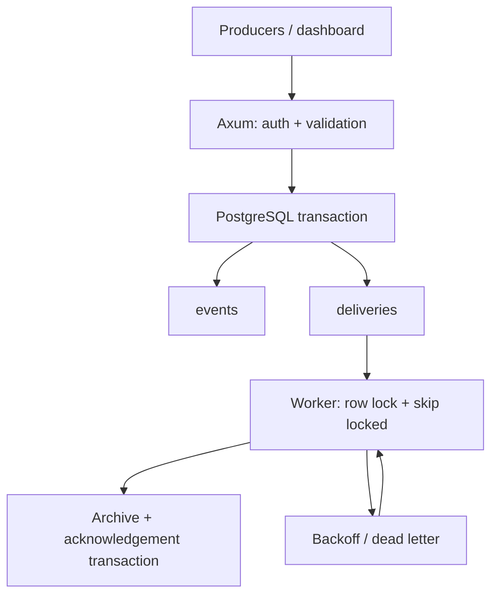

# Architecture and delivery guarantees

## Dependency boundaries

`nexus-protocol` owns the accepted wire types and validation and has no database or HTTP dependency. `nexus-store` consumes those types and owns database behavior. `nexus-api` composes both into routes and a background worker. Encoding is a public protocol function used by the actual archive sink, rather than a private unused helper hidden from Clippy.

## Ingestion transaction

1. Authentication and a 1 MiB request limit run before ingestion.
2. Validate the complete batch: count, unique non-nil UUIDs, names, JSON object shape, 64 KiB payload limit.
3. Sort by UUID so overlapping batches acquire uniqueness locks in a consistent order.
4. Insert each event with `ON CONFLICT DO NOTHING`.
5. If inserted, create its pending delivery in the same transaction.
6. If already present, compare source/kind/JSON payload. A mismatch aborts the complete batch.
7. Commit, then return 202. Nothing is buffered only in process memory.

For JSON object comparison PostgreSQL JSONB semantics ignore key order. Producer IDs identify events globally inside this workspace. Events have no mutable update API. Retrying after an ambiguous response must reuse IDs and content.

## Worker transaction

A due pending delivery is selected with `FOR UPDATE OF d SKIP LOCKED`. The lock stays held while the worker inserts the encoded event into the internal archive and marks delivery done. Both commit atomically. Another worker skips that row. A crash before commit releases the lock and rolls the work back; a later worker retries it.

An archive savepoint allows a sink SQL error to be rolled back without poisoning the whole transaction. Failed attempts increment a durable counter, set a backoff of 2, 4, 8, and 16 seconds before subsequent tries, and become dead on the fifth failure. Dead records remain inspectable via counts and can be requeued by UUID. If the whole transaction or database fails, no attempt is committed; the worker logs an error and retries after two seconds. Metrics therefore describe committed delivery states, not every transient database error.

The internal archive is effectively once per ID because its primary key and acknowledgement share a transaction. This guarantee **does not extend to a future external HTTP/Kafka/S3 destination**. Such a destination must handle duplicate deliveries and should use a lease/outbox protocol rather than holding database locks over network I/O.

## Pagination

Reads use `seq < before ORDER BY seq DESC`, fetching one extra row to decide whether to return `next_cursor`. Sequence values may have gaps. This avoids offset scans and duplicate pages for ordinary reads. It is not a cross-request snapshot: concurrent transactions may allocate sequence values and commit in different orders. Refresh newest to see late commits.

## Shutdown and backpressure

HTTP drains on Ctrl-C/SIGTERM, then the background worker is stopped and the database pool is closed. The bounded pool has 20 connections and a five-second acquisition timeout. Request bodies, batches, and payloads are bounded. The service does not implement a global queue-size admission limit; protect disk capacity and request rates at the deployment boundary.

## Deliberate choices

- PostgreSQL instead of an additional broker: easier atomicity and a smaller operational footprint; not a Kafka replacement.
- Single archive adapter: runnable, deterministic end-to-end behavior without fake integrations.
- No React dependency: the dashboard is small, accessible, and shipped in the same binary with no cross-origin auth configuration.
- Parameterized dynamic SQL: offline compilation without SQLx metadata drift; real database tests verify SQL behavior.
